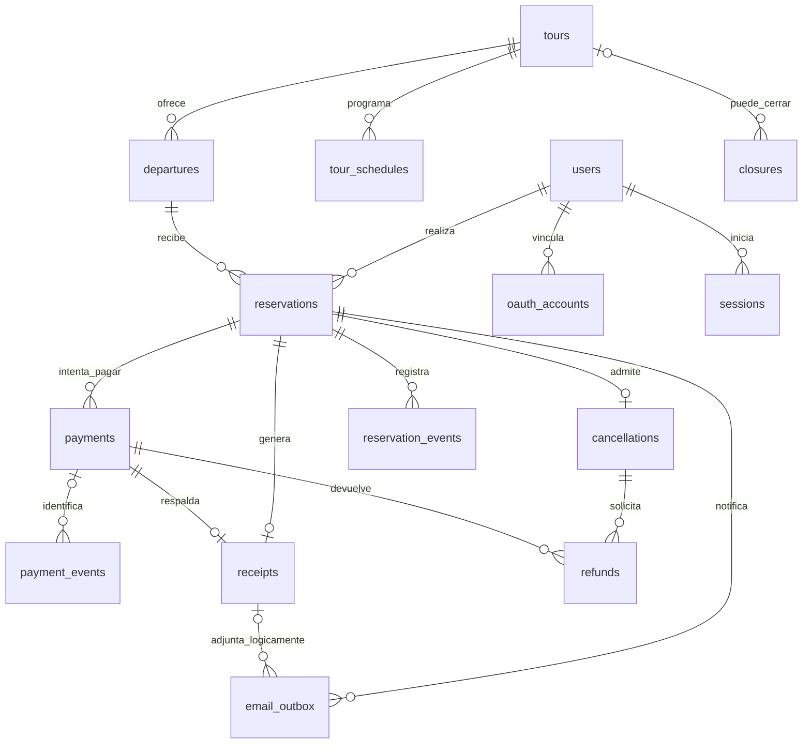

# Base de datos para reservas de tours de cuevas

Fecha: 18 de noviembre de 2026. Análisis del código local; no se accedió a Neon ni a datos productivos.

## Resultado y compatibilidad

El negocio necesita registrar **quién reserva, qué salida del tour reserva, cuántos cupos ocupa, cuánto debe pagar, si la pasarela confirmó el pago, qué comprobante se emitió y si hubo cancelación/devolución**. También necesita una cola de correo para reintentar entregas fallidas sin repetir el cobro.

La estructura completa propuesta contiene **21 tablas y 222 columnas**, incluyendo las tablas técnicas y editoriales que ya requiere el sitio. Las principales son `users`, `tours`, `departures`, `reservations`, `payments`, `receipts`, `cancellations`, `refunds` y `email_outbox`. No hacen falta tablas de productos físicos, carrito, inventario de mercancía ni guías asignados: esos procesos no aparecen en el código actual. Los participantes se registran como cantidad; no se inventa una lista de personas por reserva.

**Distinción esencial:** `server/db.js` hoy usa solo cuatro tablas físicas: `kanba_store`, `kanba_media`, `kanba_rate_limits` y `kanba_oauth_states`. Usuarios, tours, reservas, sesiones y correos viven dentro de `kanba_store.doc`, un documento JSONB. No existe `data/db.json` en este checkout. `server/migrations.js` contiene un modelo relacional anterior incompleto y no es el repositorio activo.

Por eso se entregan dos scripts con objetivos diferentes:

| Archivo | Para qué sirve | ¿Lo usa directamente el código actual? |
| --- | --- | --- |
| [neon-modelo-relacional.sql](../sql/neon-modelo-relacional.sql) | Crear las 21 tablas del modelo objetivo en `kanba_rel`, con PK, FK, índices y restricciones | **No.** Requiere adaptar `server/db.js`/`server/store.js` y migrar los datos |
| [neon-esquema-actual.sql](../sql/neon-esquema-actual.sql) | Crear las cuatro tablas que el repositorio actual espera en `kanba` | **Sí**, con `DB_SCHEMA=kanba` y documento inicial válido |

No cambiar simplemente `DB_SCHEMA` a `kanba_rel`: el código seguiría buscando `kanba_store`. Ejecutar DDL crea estructuras; no cambia rutas, no activa pagos y no envía correos.

## Evidencia utilizada y decisiones

| Código / dato actual | Entidades propuestas | Decisión |
| --- | --- | --- |
| `store.js`: `registerUser`, `registerGoogleUser`, `linkGoogleAccount`, `userSessions`; `routes.js`: login administrador | users, oauth_accounts, sessions | Clientes y administradores nominales; contraseña nullable para Google; sin guardar tokens OAuth |
| `db.js`: state OAuth y contadores de tasa | oauth_states, rate_limits | Estado distribuido, vencimiento, consumo único y limitación entre instancias |
| `defaultTours`, `buildAvailability`, `seatsTaken`; CRUD de tours | tours, tour_schedules, departures | Catálogo separado de cada salida fechada y de su capacidad |
| `closures` y rutas administrativas de cierres | closures | `tour_id NULL` reemplaza el valor especial `all` |
| `createReservation`: titular, cantidad, precio, token, `requestId`/`requestDigest` | reservations | Precio/contacto históricos, bloqueo temporal de cupos e idempotencia por usuario |
| `reservation.payment`, `/api/payments/*`, `/api/webhooks/payments` | payments, payment_events | Intentos separados y deduplicación de eventos, sin datos bancarios |
| `reservation.receipt`, `nextReceiptNumber` | receipts, counters | Comprobante único y folio; snapshot de emisor y compra |
| `cancelReservation`, `policyFor`, lista `refunds` | cancellations, refunds | Separar cancelación comercial del movimiento de dinero |
| `reservation.history` | reservation_events | Historial con actor y fecha |
| `mailer.js`: `sendMail`, `processEmailRetryQueue` | email_outbox | Cola, reclamación temporal, intentos, errores saneados y entrega posterior al commit |
| `content`, `settings`, subida de imágenes | site_content, settings, media | Mantener flexibilidad editorial con JSONB; imágenes como BYTEA, tal como hoy |

Se conserva `TEXT` para IDs de entidades que ya usan valores como `usr_*`, `res_*`, `ref_*` o slugs de tour. El valor predeterminado de los nuevos IDs de texto es un UUID convertido a texto; al migrar se pueden insertar los IDs existentes. Las entidades nuevas de horarios, salidas e historial utilizan `BIGINT GENERATED ALWAYS AS IDENTITY`.

Los importes usan `NUMERIC(12,2)`, evitando los errores de aproximación de `FLOAT`. La moneda usa códigos de tres letras, con `GTQ` predeterminado donde corresponde. Fechas de sucesos: `TIMESTAMPTZ`; fecha/hora del tour: `DATE` + `TIME`, interpretadas en `America/Guatemala`. [Tipos numéricos de PostgreSQL](https://www.postgresql.org/docs/current/datatype-numeric.html).

El modelo mantiene una compra de un tour para N participantes y pago completo, sin anticipos ni carrito de múltiples tours. Se conserva el precio cuando se reserva; cambiar el catálogo no cambia compras existentes. La política actual es 100% de devolución con al menos 72 horas, 50% entre 24 y 72 horas, y 0% con menos de 24 horas; se registra la política y el importe realmente aplicados, incluyendo decisiones administrativas.

Mejoras propuestas respecto al documento actual: salidas concretas para bloquear cupos; intentos de pago y eventos separados; hashes de tokens; identidades Google únicas; versiones/fecha de aceptación; comprobante con snapshot de emisor; deduplicación del outbox. Son cambios de modelo que requieren implementación, no funciones ya activadas por crear tablas.

## Relaciones principales



Las FK compuestas impiden asociar un comprobante, una devolución o un evento de otro comercio a un pago equivocado. Un pago debe coincidir con la reserva en importe y moneda. Una cancelación conserva el total original y no puede autorizar un importe mayor. Los registros financieros usan `ON DELETE RESTRICT`; cancelar es un cambio de estado, no un `DELETE`. Las sesiones/identidades externas se pueden eliminar con su usuario cuando no haya reservas que impidan eliminarlo; la anonimización y retención se gestionan mediante un procedimiento separado.

## Flujo de negocio que debe implementar el repositorio relacional

1. **Reservar:** autenticar al usuario; validar tour activo, calendario, cierres, anticipación y número de participantes. Crear/obtener una fila de `departures`; bloquearla con `SELECT ... FOR UPDATE`. Bajo ese mismo bloqueo, sumar cupos de reservas confirmadas y pendientes cuyo `hold_expires_at > now()`, comprobar capacidad e insertar la reserva. Mantener el límite actual de tres pendientes por usuario con un bloqueo adicional sobre su fila de `users`. Todos los caminos que reservan, confirman, cancelan, expiran o alteran capacidad deben coordinar estos bloqueos en un orden consistente.
2. **Reintentos:** consultar `(user_id,request_id)` y comparar `request_digest`. La misma clave con contenido diferente se rechaza; no crea otra reserva. Al cambiar de estado, bloquear también la reserva correspondiente.
3. **Pagar:** crear intento con importe/moneda del servidor; enviar idempotency key al procesador. El cliente paga en el checkout del proveedor. Una redirección de navegador no confirma una compra.
4. **Confirmar:** verificar firma/autenticidad del webhook con el protocolo del procesador antes de escribir el evento. Verificar comercio, entorno, referencia, importe y moneda. En una transacción, deduplicar `payment_events`, actualizar `payments` y `reservations`, crear `receipts` y encolar los correos de confirmación/comprobante. Si el cupo venció, resolver disponibilidad o devolución antes de confirmar; no reactivar una reserva cancelada por un webhook tardío.
5. **Enviar comprobante:** después del commit, un worker reclama el correo con lease y envía. Si falla, incrementa intentos y agenda reintento. `sent` indica aceptación por el transporte; no prueba que el destinatario lo haya leído ni que no haya rebote. Un reenvío intencional recibe una `dedupe_key` nueva; el correo inicial usa una clave determinista, por ejemplo `receipt:<reservationId>:initial`.
6. **Cancelar:** comprobar titularidad/rol, bloquear reserva y salida, registrar `cancellations`, cambiar estado, revocar enlace, liberar cupos y encolar correo. Si corresponde, crear `refunds.pending`. La reserva sigue cancelada aunque el proveedor tarde en devolver dinero.
7. **Reembolsar:** bloquear pago/cancelación; calcular la suma de devoluciones `pending`, `processing` y `processed` antes de autorizar otra. Esa suma no puede superar el menor entre el pago capturado y lo autorizado por la cancelación. Persistir la solicitud, llamar al proveedor fuera de la transacción con idempotencia y reconciliar su resultado. Ante timeout incierto, consultar al proveedor antes de reintentar/liberar el importe reservado. Solo marcar `processed` tras confirmar el resultado.

**Límites del DDL:** un `CHECK` no valida sumas de otras filas ni el estado de otra tabla. Por eso el SQL, por sí solo, no evita sobreventa, reembolsos agregados excesivos, cambios ilegales de estado ni emisión de comprobantes de pagos no confirmados; esas reglas requieren las transacciones anteriores. El índice de un pago confirmado por reserva protege el registro, pero no puede impedir un cargo externo duplicado si el backend omite la idempotencia del proveedor. [Restricciones de PostgreSQL](https://www.postgresql.org/docs/current/ddl-constraints.html).

## Sin datos bancarios

No se crean campos para PAN, CVV, fecha de vencimiento, cuenta, IBAN, PIN, token de tarjeta reutilizable, ni credenciales de banca. Aunque el código actual conserva `brand` y `last4`, se omiten del modelo solicitado: adaptar las vistas y plantillas que los muestran durante la migración.

Sí se guardan importe, moneda, proveedor, estado e IDs de la orden, pago, evento o devolución. Son referencias operativas de transacción, no datos bancarios; deben tratarse como información interna. No almacenar cuerpos íntegros de webhooks: pueden incluir datos del pagador o de tarjeta. Tampoco añadirlos a JSONB, errores, historial, correos o archivos. Las claves del proveedor y SMTP permanecen en el gestor de secretos.

La tabla `settings` bloquea nombres secretos conocidos de primer nivel, pero eso no sustituye una lista explícita de campos permitidos en el backend. `site_content` es solo contenido editorial. Los correos pueden contener datos personales y enlaces privados: restringir acceso y aplicar retención. `customer_document` se mantiene nullable por compatibilidad del formulario; no es necesario para procesar un pago y no se debe recopilar sin una necesidad del negocio.

## Ejecutar en Neon

1. Seleccionar en Neon la rama y base correctas, preferiblemente una rama de pruebas. Abrir **SQL Editor**.
2. Para el modelo objetivo, copiar y ejecutar **completo** `sql/neon-modelo-relacional.sql`. Incluye `BEGIN`/`COMMIT`, no necesita extensiones y crea `kanba_rel`. Si el esquema ya existe, el script se detiene y revierte; no borra ni sustituye tablas existentes. No es un migrador de versiones.
3. Verificar las tablas:

```sql
SELECT table_name
FROM information_schema.tables
WHERE table_schema = 'kanba_rel' AND table_type = 'BASE TABLE'
ORDER BY table_name;
```

El resultado esperado es 21 tablas. Solo se inicializan los dos contadores en cero; no se crean cuentas, tours, contraseñas ni transacciones de ejemplo. No ejecutar el script dos veces esperando una actualización automática. [SQL Editor de Neon](https://neon.com/docs/get-started/query-with-neon-sql-editor).

Para **usar la aplicación actual inmediatamente**, ejecutar en cambio `sql/neon-esquema-actual.sql` y configurar `DB_SCHEMA=kanba`. En una base nueva, después de configurar `.env`, inicializar con `npm run db:init -- --initialize-empty`; genera el documento de negocio sin reservas ni usuarios demo. No insertar `doc='{}'`: no contiene el catálogo ni las estructuras que espera el código. Si ya existe un documento válido, conservarlo y no repetir la inicialización. Los pagos reales permanecen bloqueados hasta integrar una pasarela validada.

Para adoptar el modelo relacional: implementar repositorio y transacciones, transformar `days x times` en horarios, crear salidas por reservas existentes, convertir IDs y referencias, extraer pagos/comprobantes/cancelaciones/outbox, transformar el administrador global en usuario nominal, revocar sesiones o migrarlas con hashes y actualizar los contadores al mayor folio existente. Los tokens privados deben hashearse y sus usos adaptarse; no inventar evidencias de aceptación histórica que nunca se guardaron. Mantener los importes y estados durante la reconciliación. La migración antigua de `server/migrations.js` no cubre este esquema y no debe ejecutarse contra él.

El documento JSONB y las tablas nuevas no deben convertirse en dos fuentes activas simultáneas. Validar una importación en una rama aislada, comparar reservas/importes/saldos y luego hacer un corte controlado. Este trabajo entrega análisis y DDL, no modifica el código de negocio ni ejecuta cambios en Neon.

## Validación realizada

Los dos scripts se ejecutaron en un motor PostgreSQL local aislado (PGlite / PostgreSQL 18.6). Se verificaron creación, repetición del esquema compatible, 21 tablas, unicidad de emails/eventos/correos, FK, importes y moneda, pago confirmado único, pertenencia del comprobante/devolución, estados del outbox, cierre global único y protección contra borrado de tours referenciados. No se hicieron conexiones a Neon ni cobros/envíos reales. El resultado local no certifica la configuración de producción ni las reglas transaccionales pendientes.

## Listado completo de tablas

| Tabla | Función |
| --- | --- |
| `users` | Clientes y administradores nominales; password nullable para cuentas Google. No guarda contrasenas en claro. |
| `oauth_accounts` | Identidad externa verificada de Google; no almacena access_token ni refresh_token. |
| `sessions` | Sesiones de usuario y administrador; guardar SHA-256 del token aleatorio, no la cookie original. |
| `oauth_states` | Desafio de OAuth temporal y de un solo uso; consumir con DELETE RETURNING. |
| `tours` | Catalogo de experiencias; precio por participante. Archivar con active=false si tiene reservas. |
| `tour_schedules` | Horarios semanales: 0 domingo, 6 sabado; horas locales America/Guatemala. Expande tours.days x tours.times. |
| `departures` | Salida concreta por fecha/hora. Fila de bloqueo para evitar sobreventa entre reservas concurrentes. |
| `closures` | Cierre por mantenimiento/clima; tour_id NULL equivale al valor actual all: cierra todos los tours ese dia. |
| `reservations` | Compra de un tour para N participantes; conserva precio/contacto al reservar y deduplica reintentos del navegador. |
| `payments` | Intentos/ordenes del procesador, importe y estado. Un cobro completo confirmado por reserva; no guarda datos de tarjeta ni tokens de cargo. |
| `payment_events` | Deduplicacion de webhooks autenticados. Solo resumen permitido; nunca guardar cuerpo completo, firma secreta o datos bancarios. |
| `receipts` | Comprobante comercial del pago; conserva datos de emision. No supone integracion de factura fiscal. No borrar al cancelar. |
| `cancellations` | Motivo y politica aplicada al cancelar; cancelar no significa que el procesador ya haya devuelto dinero. |
| `refunds` | Devoluciones al procesador original: referencia e importe, sin datos de destino bancario. Limite agregado requiere transaccion de negocio. |
| `reservation_events` | Historial de creacion, pago, expiracion, cancelacion y devolucion; no incluir secretos en label. |
| `email_outbox` | Cola durable de correos creada en la transaccion de negocio; envio despues del commit y reintentos con lease. |
| `site_content` | Contenido editorial por seccion: portada, contacto, galeria, videos, cafeteria. JSONB deliberado para estructura variable. |
| `settings` | Configuracion no secreta; el backend debe aplicar whitelist tambien a claves anidadas. Credenciales en gestor de secretos. |
| `media` | Imagenes del administrador, como kanba_media actual. No comprobantes bancarios ni documentos de identidad. |
| `rate_limits` | Limitacion distribuida de intentos por accion/cuenta/IP; aplicar retencion corta. |
| `counters` | Folios correlativos comerciales. Incrementar con UPDATE RETURNING, nunca SELECT + UPDATE separado; no reiniciar al migrar. |

## Diccionario de columnas

**PK** = PRIMARY KEY; **FK** = FOREIGN KEY; **UQ** = UNIQUE. «Obligatorio» significa NOT NULL. Las FK compuestas se verifican juntas: compartir una columna no convierte cada referencia individual en independiente. Los IDs IDENTITY se generan en PostgreSQL. Los índices parciales y las reglas CHECK completas están en el SQL.

Los tipos y claves de este diccionario se obtuvieron del catálogo PostgreSQL después de ejecutar el script, para mantenerlos alineados con el DDL.

### 1. `users`

Clientes y administradores nominales; password nullable para cuentas Google. No guarda contrasenas en claro.

| Columna | Tipo PostgreSQL | Claves | Obligatorio | Valor inicial / nota |
| --- | --- | --- | --- | --- |
| `id` | `TEXT` | PK | Sí | `(gen_random_uuid())::text` |
| `name` | `VARCHAR(120)` | — | Sí | — |
| `email` | `VARCHAR(254)` | UQ sin distinguir mayúsculas | Sí | — |
| `phone` | `VARCHAR(40)` | — | No | — |
| `country` | `VARCHAR(100)` | — | No | — |
| `password_salt` | `TEXT` | — | No | — |
| `password_hash` | `TEXT` | — | No | — |
| `password_algorithm` | `VARCHAR(30)` | — | Sí | `'scrypt'::character varying` |
| `password_policy_version` | `SMALLINT` | — | Sí | `2` |
| `role` | `VARCHAR(20)` | — | Sí | `'user'::character varying` |
| `avatar_url` | `TEXT` | — | No | — |
| `disabled_at` | `TIMESTAMPTZ` | — | No | — |
| `created_at` | `TIMESTAMPTZ` | — | Sí | `now()` |
| `updated_at` | `TIMESTAMPTZ` | — | Sí | `now()` |

### 2. `oauth_accounts`

Identidad externa verificada de Google; no almacena access_token ni refresh_token.

| Columna | Tipo PostgreSQL | Claves | Obligatorio | Valor inicial / nota |
| --- | --- | --- | --- | --- |
| `id` | `BIGINT` | PK | Sí | IDENTITY |
| `user_id` | `TEXT` | FK → `users.id`, UQ compuesta | Sí | — |
| `provider` | `VARCHAR(40)` | UQ compuesta | Sí | — |
| `provider_subject` | `VARCHAR(255)` | UQ compuesta | Sí | — |
| `created_at` | `TIMESTAMPTZ` | — | Sí | `now()` |

Unicidad compuesta: `UNIQUE (provider, provider_subject)`; `UNIQUE (user_id, provider)`.

### 3. `sessions`

Sesiones de usuario y administrador; guardar SHA-256 del token aleatorio, no la cookie original.

| Columna | Tipo PostgreSQL | Claves | Obligatorio | Valor inicial / nota |
| --- | --- | --- | --- | --- |
| `token_hash` | `VARCHAR(64)` | PK | Sí | — |
| `user_id` | `TEXT` | FK → `users.id` | Sí | — |
| `kind` | `VARCHAR(20)` | — | Sí | — |
| `ip_address` | `INET` | — | No | — |
| `created_at` | `TIMESTAMPTZ` | — | Sí | `now()` |
| `last_seen_at` | `TIMESTAMPTZ` | — | Sí | `now()` |
| `expires_at` | `TIMESTAMPTZ` | — | Sí | — |
| `revoked_at` | `TIMESTAMPTZ` | — | No | — |

### 4. `oauth_states`

Desafio de OAuth temporal y de un solo uso; consumir con DELETE RETURNING.

| Columna | Tipo PostgreSQL | Claves | Obligatorio | Valor inicial / nota |
| --- | --- | --- | --- | --- |
| `state_hash` | `VARCHAR(64)` | PK | Sí | — |
| `browser_hash` | `VARCHAR(64)` | — | Sí | — |
| `next_path` | `TEXT` | — | Sí | `'/'::text` |
| `expires_at` | `TIMESTAMPTZ` | — | Sí | — |
| `created_at` | `TIMESTAMPTZ` | — | Sí | `now()` |

### 5. `tours`

Catalogo de experiencias; precio por participante. Archivar con active=false si tiene reservas.

| Columna | Tipo PostgreSQL | Claves | Obligatorio | Valor inicial / nota |
| --- | --- | --- | --- | --- |
| `id` | `TEXT` | PK | Sí | — |
| `name` | `VARCHAR(160)` | — | Sí | — |
| `badge` | `VARCHAR(40)` | — | No | — |
| `description` | `TEXT` | — | Sí | `''::text` |
| `long_description` | `TEXT` | — | Sí | `''::text` |
| `duration_label` | `VARCHAR(40)` | — | Sí | — |
| `duration_minutes` | `INTEGER` | — | Sí | — |
| `price` | `NUMERIC(12,2)` | — | Sí | — |
| `currency` | `VARCHAR(3)` | — | Sí | `'GTQ'::character varying` |
| `capacity` | `INTEGER` | — | Sí | — |
| `min_participants` | `INTEGER` | — | Sí | `1` |
| `max_participants` | `INTEGER` | — | Sí | — |
| `difficulty` | `VARCHAR(80)` | — | Sí | `''::character varying` |
| `min_age` | `SMALLINT` | — | Sí | `0` |
| `meeting_point` | `TEXT` | — | Sí | `''::text` |
| `includes` | `TEXT[]` | — | Sí | `'{}'::text[]` |
| `not_includes` | `TEXT[]` | — | Sí | `'{}'::text[]` |
| `image_url` | `TEXT` | — | No | — |
| `active` | `BOOLEAN` | — | Sí | `true` |
| `featured` | `BOOLEAN` | — | Sí | `false` |
| `created_at` | `TIMESTAMPTZ` | — | Sí | `now()` |
| `updated_at` | `TIMESTAMPTZ` | — | Sí | `now()` |

### 6. `tour_schedules`

Horarios semanales: 0 domingo, 6 sabado; horas locales America/Guatemala. Expande tours.days x tours.times.

| Columna | Tipo PostgreSQL | Claves | Obligatorio | Valor inicial / nota |
| --- | --- | --- | --- | --- |
| `id` | `BIGINT` | PK | Sí | IDENTITY |
| `tour_id` | `TEXT` | FK → `tours.id`, UQ compuesta | Sí | — |
| `weekday` | `SMALLINT` | UQ compuesta | Sí | — |
| `local_time` | `TIME` | UQ compuesta | Sí | — |
| `active` | `BOOLEAN` | — | Sí | `true` |

Unicidad compuesta: `UNIQUE (tour_id, weekday, local_time)`.

### 7. `departures`

Salida concreta por fecha/hora. Fila de bloqueo para evitar sobreventa entre reservas concurrentes.

| Columna | Tipo PostgreSQL | Claves | Obligatorio | Valor inicial / nota |
| --- | --- | --- | --- | --- |
| `id` | `BIGINT` | PK | Sí | IDENTITY |
| `tour_id` | `TEXT` | FK → `tours.id`, UQ compuesta | Sí | — |
| `local_date` | `DATE` | UQ compuesta | Sí | — |
| `local_time` | `TIME` | UQ compuesta | Sí | — |
| `time_zone` | `VARCHAR(64)` | — | Sí | `'America/Guatemala'::character varying` |
| `capacity` | `INTEGER` | — | Sí | — |
| `status` | `VARCHAR(20)` | — | Sí | `'open'::character varying` |
| `created_at` | `TIMESTAMPTZ` | — | Sí | `now()` |
| `updated_at` | `TIMESTAMPTZ` | — | Sí | `now()` |

Unicidad compuesta: `UNIQUE (tour_id, local_date, local_time)`.

### 8. `closures`

Cierre por mantenimiento/clima; tour_id NULL equivale al valor actual all: cierra todos los tours ese dia.

| Columna | Tipo PostgreSQL | Claves | Obligatorio | Valor inicial / nota |
| --- | --- | --- | --- | --- |
| `id` | `TEXT` | PK | Sí | `(gen_random_uuid())::text` |
| `tour_id` | `TEXT` | FK → `tours.id` | No | — |
| `local_date` | `DATE` | — | Sí | — |
| `reason` | `VARCHAR(300)` | — | Sí | — |
| `created_by` | `TEXT` | FK → `users.id` | No | — |
| `created_at` | `TIMESTAMPTZ` | — | Sí | `now()` |

### 9. `reservations`

Compra de un tour para N participantes; conserva precio/contacto al reservar y deduplica reintentos del navegador.

| Columna | Tipo PostgreSQL | Claves | Obligatorio | Valor inicial / nota |
| --- | --- | --- | --- | --- |
| `id` | `TEXT` | PK, UQ compuesta | Sí | `(gen_random_uuid())::text` |
| `code` | `VARCHAR(40)` | UQ | Sí | — |
| `user_id` | `TEXT` | FK → `users.id`, UQ compuesta | Sí | — |
| `departure_id` | `BIGINT` | FK → `departures.id` | Sí | — |
| `request_id` | `VARCHAR(80)` | UQ compuesta | Sí | — |
| `request_digest` | `VARCHAR(64)` | — | Sí | — |
| `tour_name_snapshot` | `VARCHAR(160)` | — | Sí | — |
| `participants` | `INTEGER` | — | Sí | — |
| `unit_price` | `NUMERIC(12,2)` | — | Sí | — |
| `total` | `NUMERIC(12,2)` | UQ compuesta | Sí | — |
| `currency` | `VARCHAR(3)` | UQ compuesta | Sí | `'GTQ'::character varying` |
| `status` | `VARCHAR(24)` | — | Sí | `'pending_payment'::character varying` |
| `customer_name` | `VARCHAR(120)` | — | Sí | — |
| `customer_email` | `VARCHAR(254)` | — | Sí | — |
| `customer_phone` | `VARCHAR(40)` | — | Sí | — |
| `customer_country` | `VARCHAR(100)` | — | Sí | — |
| `customer_document` | `TEXT` | — | No | — Campo opcional heredado del formulario; no recopilar identificacion si el negocio no la necesita. |
| `customer_notes` | `VARCHAR(600)` | — | No | — |
| `created_by_role` | `VARCHAR(20)` | — | Sí | `'user'::character varying` |
| `access_token_hash` | `VARCHAR(64)` | — | Sí | — SHA-256 del enlace privado; requiere adaptar el repositorio actual, que guarda el token original. |
| `token_expires_at` | `TIMESTAMPTZ` | — | Sí | — |
| `token_revoked_at` | `TIMESTAMPTZ` | — | No | — |
| `hold_expires_at` | `TIMESTAMPTZ` | — | Sí | — |
| `paid_at` | `TIMESTAMPTZ` | — | No | — |
| `cancelled_at` | `TIMESTAMPTZ` | — | No | — |
| `policies_version` | `VARCHAR(80)` | — | No | — |
| `terms_version` | `VARCHAR(80)` | — | No | — |
| `accepted_at` | `TIMESTAMPTZ` | — | No | — Evidencia nueva: el codigo actual valida casillas pero no persiste fecha/version. No inventar valores al importar historicos. |
| `created_at` | `TIMESTAMPTZ` | — | Sí | `now()` |
| `updated_at` | `TIMESTAMPTZ` | — | Sí | `now()` |

Unicidad compuesta: `UNIQUE (id, total, currency)`; `UNIQUE (user_id, request_id)`.

### 10. `payments`

Intentos/ordenes del procesador, importe y estado. Un cobro completo confirmado por reserva; no guarda datos de tarjeta ni tokens de cargo.

| Columna | Tipo PostgreSQL | Claves | Obligatorio | Valor inicial / nota |
| --- | --- | --- | --- | --- |
| `id` | `TEXT` | PK, UQ compuesta | Sí | `(gen_random_uuid())::text` |
| `reservation_id` | `TEXT` | FK → `reservations.id`, UQ compuesta | Sí | — |
| `provider` | `VARCHAR(80)` | UQ compuesta | Sí | — |
| `environment` | `VARCHAR(12)` | UQ compuesta | Sí | — |
| `merchant_id` | `VARCHAR(255)` | UQ compuesta | Sí | — |
| `provider_intent_id` | `VARCHAR(255)` | UQ compuesta | No | — |
| `provider_payment_id` | `VARCHAR(255)` | UQ compuesta | No | — |
| `idempotency_key` | `VARCHAR(128)` | UQ compuesta | Sí | — |
| `amount` | `NUMERIC(12,2)` | FK → `reservations.total`, UQ compuesta | Sí | — |
| `currency` | `VARCHAR(3)` | FK → `reservations.currency`, UQ compuesta | Sí | — |
| `status` | `VARCHAR(24)` | — | Sí | `'requires_payment'::character varying` |
| `attempts` | `INTEGER` | — | Sí | `0` |
| `failure_code` | `VARCHAR(100)` | — | No | — |
| `manual` | `BOOLEAN` | — | Sí | `false` |
| `paid_at` | `TIMESTAMPTZ` | — | No | — |
| `created_at` | `TIMESTAMPTZ` | — | Sí | `now()` |
| `updated_at` | `TIMESTAMPTZ` | — | Sí | `now()` |

Unicidad compuesta: `UNIQUE (id, provider, environment, merchant_id)`; `UNIQUE (id, reservation_id, amount, currency)`; `UNIQUE (id, reservation_id, currency)`; `UNIQUE (provider, environment, merchant_id, idempotency_key)`; `UNIQUE (provider, environment, merchant_id, provider_intent_id)`; `UNIQUE (provider, environment, merchant_id, provider_payment_id)`.

### 11. `payment_events`

Deduplicacion de webhooks autenticados. Solo resumen permitido; nunca guardar cuerpo completo, firma secreta o datos bancarios.

| Columna | Tipo PostgreSQL | Claves | Obligatorio | Valor inicial / nota |
| --- | --- | --- | --- | --- |
| `id` | `BIGINT` | PK | Sí | IDENTITY |
| `payment_id` | `TEXT` | FK → `payments.id` | No | — |
| `provider` | `VARCHAR(80)` | FK → `payments.provider`, UQ compuesta | Sí | — |
| `environment` | `VARCHAR(12)` | FK → `payments.environment`, UQ compuesta | Sí | — |
| `merchant_id` | `VARCHAR(255)` | FK → `payments.merchant_id`, UQ compuesta | Sí | — |
| `provider_event_id` | `VARCHAR(255)` | UQ compuesta | Sí | — |
| `provider_object_id` | `VARCHAR(255)` | — | Sí | — |
| `event_type` | `VARCHAR(100)` | — | Sí | — |
| `provider_created_at` | `TIMESTAMPTZ` | — | No | — |
| `received_at` | `TIMESTAMPTZ` | — | Sí | `now()` |
| `processed_at` | `TIMESTAMPTZ` | — | No | — |
| `status` | `VARCHAR(20)` | — | Sí | `'received'::character varying` |
| `error_code` | `VARCHAR(100)` | — | No | — |

Unicidad compuesta: `UNIQUE (provider, environment, merchant_id, provider_event_id)`.

### 12. `receipts`

Comprobante comercial del pago; conserva datos de emision. No supone integracion de factura fiscal. No borrar al cancelar.

| Columna | Tipo PostgreSQL | Claves | Obligatorio | Valor inicial / nota |
| --- | --- | --- | --- | --- |
| `id` | `TEXT` | PK, UQ compuesta | Sí | `(gen_random_uuid())::text` |
| `number` | `VARCHAR(40)` | UQ | Sí | — |
| `reservation_id` | `TEXT` | FK → `payments.reservation_id`, UQ compuesta, UQ | Sí | — |
| `payment_id` | `TEXT` | FK → `payments.id`, UQ | Sí | — |
| `amount` | `NUMERIC(12,2)` | FK → `payments.amount` | Sí | — |
| `currency` | `VARCHAR(3)` | FK → `payments.currency` | Sí | — |
| `customer_name` | `VARCHAR(120)` | — | Sí | — |
| `customer_email` | `VARCHAR(254)` | — | Sí | — |
| `issuer_name` | `VARCHAR(160)` | — | Sí | — |
| `issuer_tax_id` | `VARCHAR(60)` | — | No | — |
| `issuer_address` | `TEXT` | — | No | — |
| `tour_name` | `VARCHAR(160)` | — | Sí | — |
| `local_date` | `DATE` | — | Sí | — |
| `local_time` | `TIME` | — | Sí | — |
| `participants` | `INTEGER` | — | Sí | — |
| `issued_at` | `TIMESTAMPTZ` | — | Sí | `now()` |

Unicidad compuesta: `UNIQUE (id, reservation_id)`.

### 13. `cancellations`

Motivo y politica aplicada al cancelar; cancelar no significa que el procesador ya haya devuelto dinero.

| Columna | Tipo PostgreSQL | Claves | Obligatorio | Valor inicial / nota |
| --- | --- | --- | --- | --- |
| `id` | `TEXT` | PK, UQ compuesta | Sí | `(gen_random_uuid())::text` |
| `reservation_id` | `TEXT` | FK → `reservations.id`, UQ compuesta, UQ | Sí | — |
| `actor_user_id` | `TEXT` | FK → `users.id` | No | — |
| `actor_kind` | `VARCHAR(20)` | — | Sí | — |
| `reason` | `VARCHAR(300)` | — | Sí | — |
| `policy_label` | `TEXT` | — | Sí | — |
| `refund_percent` | `NUMERIC(5,2)` | — | Sí | — |
| `original_total` | `NUMERIC(12,2)` | FK → `reservations.total` | Sí | — |
| `currency` | `VARCHAR(3)` | FK → `reservations.currency` | Sí | — |
| `refund_amount` | `NUMERIC(12,2)` | — | Sí | — |
| `requested_at` | `TIMESTAMPTZ` | — | Sí | `now()` |

Unicidad compuesta: `UNIQUE (id, reservation_id)`.

### 14. `refunds`

Devoluciones al procesador original: referencia e importe, sin datos de destino bancario. Limite agregado requiere transaccion de negocio.

| Columna | Tipo PostgreSQL | Claves | Obligatorio | Valor inicial / nota |
| --- | --- | --- | --- | --- |
| `id` | `TEXT` | PK | Sí | `(gen_random_uuid())::text` |
| `payment_id` | `TEXT` | FK → `payments.id`, UQ compuesta | Sí | — |
| `reservation_id` | `TEXT` | FK → `cancellations.reservation_id`, FK → `payments.reservation_id` | Sí | — |
| `cancellation_id` | `TEXT` | FK → `cancellations.id` | Sí | — |
| `amount` | `NUMERIC(12,2)` | — | Sí | — |
| `currency` | `VARCHAR(3)` | FK → `payments.currency` | Sí | — |
| `percent` | `NUMERIC(5,2)` | — | No | — |
| `method` | `VARCHAR(30)` | — | Sí | `'original_provider'::character varying` |
| `status` | `VARCHAR(20)` | — | Sí | `'pending'::character varying` |
| `idempotency_key` | `VARCHAR(128)` | UQ | Sí | — |
| `provider_refund_id` | `VARCHAR(255)` | UQ compuesta | No | — |
| `reason` | `VARCHAR(300)` | — | Sí | — |
| `requested_by` | `TEXT` | FK → `users.id` | No | — |
| `requested_at` | `TIMESTAMPTZ` | — | Sí | `now()` |
| `processed_at` | `TIMESTAMPTZ` | — | No | — |
| `error_code` | `VARCHAR(100)` | — | No | — |

Unicidad compuesta: `UNIQUE (payment_id, provider_refund_id)`.

### 15. `reservation_events`

Historial de creacion, pago, expiracion, cancelacion y devolucion; no incluir secretos en label.

| Columna | Tipo PostgreSQL | Claves | Obligatorio | Valor inicial / nota |
| --- | --- | --- | --- | --- |
| `id` | `BIGINT` | PK | Sí | IDENTITY |
| `reservation_id` | `TEXT` | FK → `reservations.id` | Sí | — |
| `actor_user_id` | `TEXT` | FK → `users.id` | No | — |
| `event_type` | `VARCHAR(50)` | — | Sí | — |
| `label` | `TEXT` | — | Sí | — |
| `created_at` | `TIMESTAMPTZ` | — | Sí | `now()` |

### 16. `email_outbox`

Cola durable de correos creada en la transaccion de negocio; envio despues del commit y reintentos con lease.

| Columna | Tipo PostgreSQL | Claves | Obligatorio | Valor inicial / nota |
| --- | --- | --- | --- | --- |
| `id` | `TEXT` | PK | Sí | `(gen_random_uuid())::text` |
| `reservation_id` | `TEXT` | FK → `receipts.reservation_id`, FK → `reservations.id` | Sí | — |
| `receipt_id` | `TEXT` | FK → `receipts.id` | No | — |
| `dedupe_key` | `VARCHAR(200)` | UQ | Sí | — |
| `recipient` | `VARCHAR(254)` | — | Sí | — |
| `subject` | `VARCHAR(300)` | — | Sí | — |
| `template` | `VARCHAR(40)` | — | Sí | — |
| `status` | `VARCHAR(20)` | — | Sí | `'queued'::character varying` |
| `provider` | `VARCHAR(80)` | — | Sí | `'outbox'::character varying` |
| `provider_message_id` | `VARCHAR(255)` | — | No | — |
| `attempts` | `INTEGER` | — | Sí | `0` |
| `next_attempt_at` | `TIMESTAMPTZ` | — | No | — |
| `claim_id` | `UUID` | — | No | — |
| `lease_expires_at` | `TIMESTAMPTZ` | — | No | — |
| `sent_at` | `TIMESTAMPTZ` | — | No | — |
| `permanent_failed` | `BOOLEAN` | — | Sí | `false` |
| `error_code` | `VARCHAR(100)` | — | No | — |
| `html_body` | `TEXT` | — | Sí | — |
| `text_body` | `TEXT` | — | Sí | — |
| `created_at` | `TIMESTAMPTZ` | — | Sí | `now()` |

### 17. `site_content`

Contenido editorial por seccion: portada, contacto, galeria, videos, cafeteria. JSONB deliberado para estructura variable.

| Columna | Tipo PostgreSQL | Claves | Obligatorio | Valor inicial / nota |
| --- | --- | --- | --- | --- |
| `section` | `VARCHAR(80)` | PK | Sí | — |
| `data` | `JSONB` | — | Sí | — |
| `updated_by` | `TEXT` | FK → `users.id` | No | — |
| `updated_at` | `TIMESTAMPTZ` | — | Sí | `now()` |

### 18. `settings`

Configuracion no secreta; el backend debe aplicar whitelist tambien a claves anidadas. Credenciales en gestor de secretos.

| Columna | Tipo PostgreSQL | Claves | Obligatorio | Valor inicial / nota |
| --- | --- | --- | --- | --- |
| `section` | `VARCHAR(40)` | PK | Sí | — |
| `data` | `JSONB` | — | Sí | — |
| `updated_by` | `TEXT` | FK → `users.id` | No | — |
| `updated_at` | `TIMESTAMPTZ` | — | Sí | `now()` |

### 19. `media`

Imagenes del administrador, como kanba_media actual. No comprobantes bancarios ni documentos de identidad.

| Columna | Tipo PostgreSQL | Claves | Obligatorio | Valor inicial / nota |
| --- | --- | --- | --- | --- |
| `name` | `TEXT` | PK | Sí | — |
| `mime` | `VARCHAR(100)` | — | Sí | — |
| `size` | `INTEGER` | — | Sí | — |
| `data` | `BYTEA` | — | Sí | — |
| `uploaded_by` | `TEXT` | FK → `users.id` | No | — |
| `created_at` | `TIMESTAMPTZ` | — | Sí | `now()` |

### 20. `rate_limits`

Limitacion distribuida de intentos por accion/cuenta/IP; aplicar retencion corta.

| Columna | Tipo PostgreSQL | Claves | Obligatorio | Valor inicial / nota |
| --- | --- | --- | --- | --- |
| `key` | `TEXT` | PK | Sí | — |
| `window_start` | `TIMESTAMPTZ` | — | Sí | — |
| `count` | `INTEGER` | — | Sí | — |

### 21. `counters`

Folios correlativos comerciales. Incrementar con UPDATE RETURNING, nunca SELECT + UPDATE separado; no reiniciar al migrar.

| Columna | Tipo PostgreSQL | Claves | Obligatorio | Valor inicial / nota |
| --- | --- | --- | --- | --- |
| `name` | `VARCHAR(30)` | PK | Sí | — |
| `value` | `BIGINT` | — | Sí | `0` |

